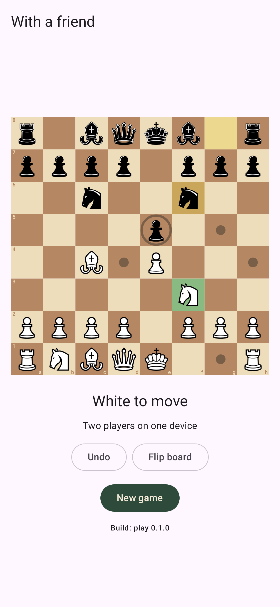
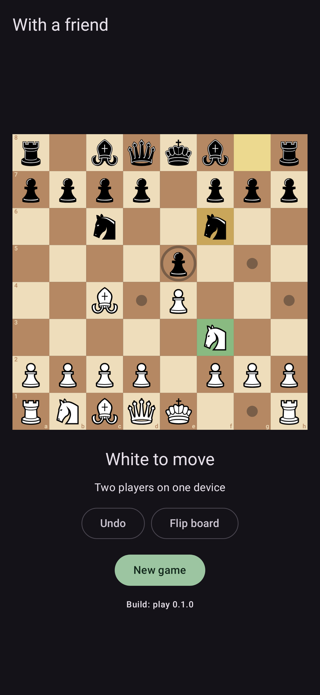
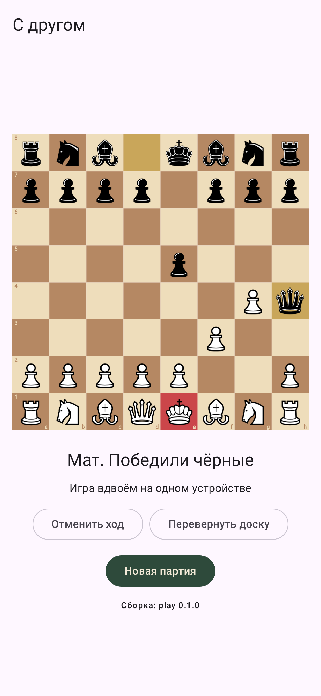
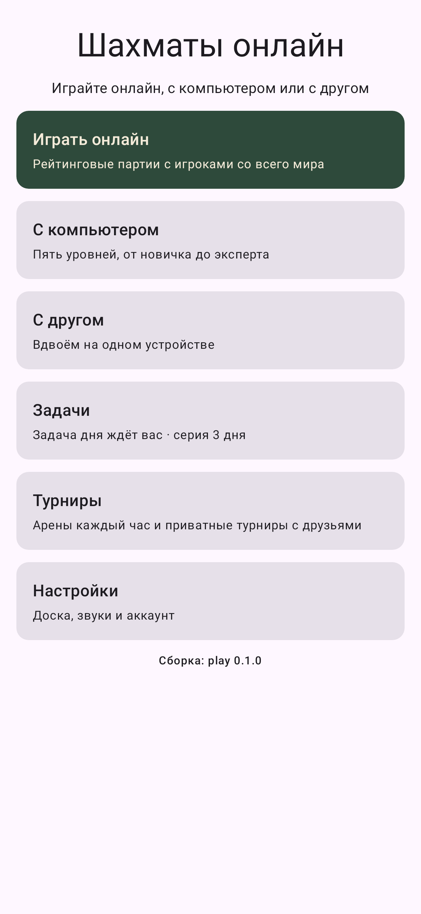
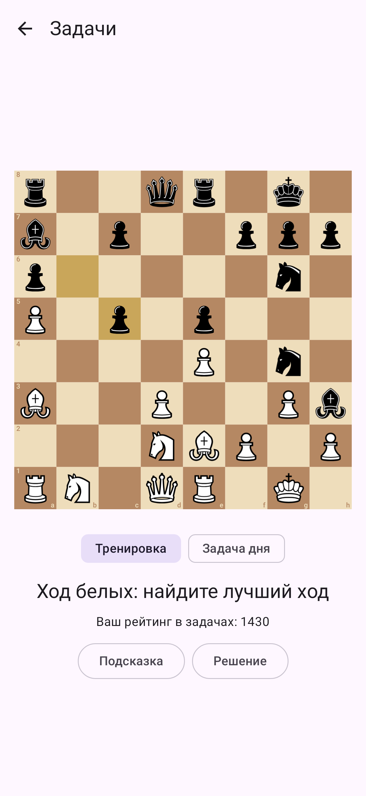
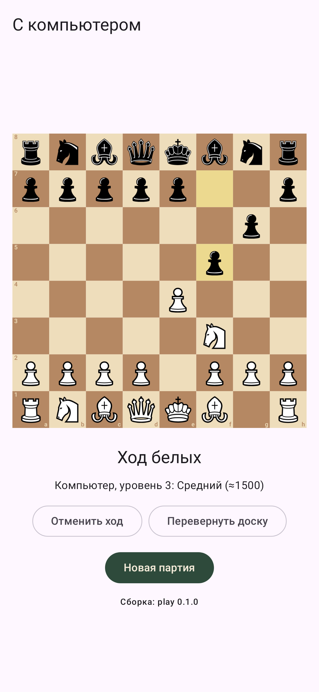
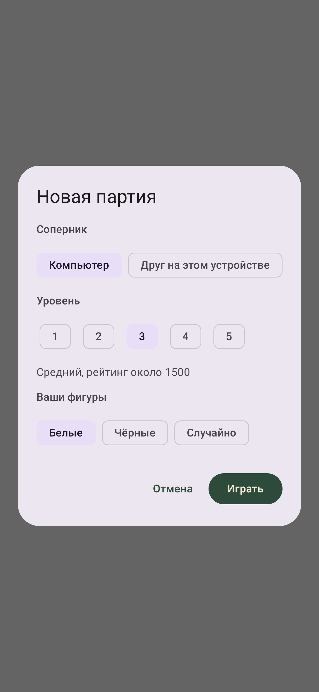

# Chess Online (MobCheckMate)

Мобильные онлайн-шахматы для Android: игра с людьми по сети, с компьютером, шахматные задачи и турниры.
Ориентир по продукту — «Chess Online – Duel friends!» (com.hagstrom.henrik.chess), но с надёжным сетевым
кодом (серверные часы, реконнект), русской локализацией, турнирами и лигами.

Публикация: Google Play (весь мир) и RuStore (Россия), затем Huawei AppGallery и Xiaomi GetApps.

## Документация

| Документ | О чём |
|---|---|
| [docs/ROADMAP.md](docs/ROADMAP.md) | Полный план: анализ референса, стек, этапы разработки, публикация, маркетинг, метрики |
| [docs/TOURNAMENTS.md](docs/TOURNAMENTS.md) | Спецификация бесплатных турниров и лиг, fair-play, модель данных |
| [docs/CHECKLIST_GOOGLE_PLAY.md](docs/CHECKLIST_GOOGLE_PLAY.md) | Чек-лист публикации в Google Play |
| [docs/CHECKLIST_RUSTORE.md](docs/CHECKLIST_RUSTORE.md) | Чек-лист публикации в RuStore |
| [docs/adr/](docs/adr/) | Архитектурные решения (ADR) |
| [docs/THIRD_PARTY_NOTICES.md](docs/THIRD_PARTY_NOTICES.md) | Сторонние компоненты и их лицензии |

## Что уже работает

- Правила шахмат в общем модуле: все ходы, включая рокировку, взятие на проходе и превращение; мат, пат,
  троекратное повторение, недостаток материала, правило 50 ходов.
- Рейтинг Glicko-2 (сверен с эталонным примером из статьи Glickman'а) и зачёт турнирной арены.
- Android-экран партии на одном устройстве: доска на Canvas, подсветка ходов, превращение пешки, отмена хода,
  переворот доски, светлая и тёмная тема, русский и английский язык, портрет и ландшафт.
- Главное меню, настройки (4 цвета доски, координаты, подсветка ходов, звуки), синтезированные звуки ходов.
- Задачи: 29 505 задач из открытой базы lichess (CC0), рейтинг в задачах (Glicko-2), подбор по рейтингу,
  задача дня и серия дней, подсказка и показ решения.
- Бот на 5 уровнях (≈800–2000, откалиброван по Stockfish): собственный движок в общем модуле, работает на
  телефоне без интернета. Младшие уровни
  ошибаются по-человечески, пятый варьирует дебюты. Перед партией выбираются соперник, уровень и цвет.
- Сервер на Ktor: проверка здоровья и WebSocket-песочница, которая проверяет каждый ход той же логикой, что и
  клиент.

| Светлая тема | Тёмная тема | Мат, русский язык |
|---|---|---|
|  |  |  |

| Главное меню | Задачи | Игра с компьютером | Новая партия |
|---|---|---|---|
|  |  |  |  |

## Структура репозитория

```
MobCheckMate/
├── shared/       # Kotlin Multiplatform: правила шахмат (kchesslib), рейтинг, правила турниров
├── androidApp/   # Android-клиент на Jetpack Compose, flavors play / rustore
├── server/       # Игровой сервер на Ktor (WebSocket)
├── tools/        # Вспомогательные скрипты (конвертер SVG в VectorDrawable)
├── third_party/  # Лицензии сторонних ассетов
└── docs/         # Roadmap, спецификации, чек-листы, ADR
```

Позже появятся `engine-worker/` (серверный Stockfish) и `pairing/` (bbpPairings для швейцарок).

## Сборка

Нужны JDK 17+ (проверено на 21) и Android SDK с платформой 37 и build-tools 37. Gradle скачивается обёрткой.
Путь к SDK задаётся в `local.properties` (`sdk.dir=/path/to/android-sdk`) или переменной `ANDROID_HOME`.

```bash
./gradlew :shared:jvmTest            # тесты правил и турнирной логики
./gradlew :server:test               # тесты сервера
./gradlew :server:run                # сервер на http://localhost:8080
./gradlew :androidApp:assemblePlayDebug      # APK для Google Play
./gradlew :androidApp:assembleRustoreDebug   # APK для RuStore
./gradlew :androidApp:testPlayDebugUnitTest  # unit-тесты экрана
./gradlew :androidApp:verifyRoborazziPlayDebug   # сравнить скриншоты с эталонами
./gradlew :androidApp:recordRoborazziPlayDebug   # перезаписать эталонные скриншоты
./gradlew :androidApp:bundlePlayRelease      # AAB для публикации (подпись настраивается отдельно)
./gradlew :shared:jvmTest -PengineMatch=10 --tests '*LevelMatchTest*'   # матчи уровней бота друг с другом
```
